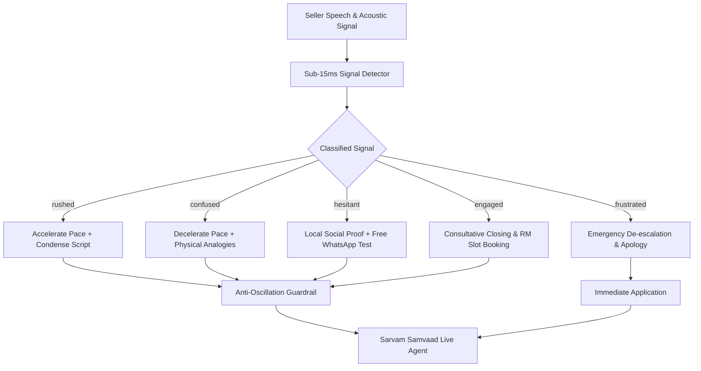

# Approach Note: Seller-Fit Adaptive Voice Persona Engine (VANI)
**Hackathon Problem Statement 4 of 6: Persona Design**

**Team Name:** IndiaMART Future VANI  
**Agent ID:** `IM-Future-0c2c99ce-3384` (Sarvam Samvaad)  
**Agent Version:** Version 17 (Committed & Deployed)  
**Knowledge Base ID:** `01a1261e-69f1-7daa-aa1d-710cc98fc453` (`indiamart-vani-knowledge-base`)  

---

## 1. Problem Context & The Core Flaw in Traditional Bots
In outbound telephonic engagement with Indian MSMEs (micro, small, and medium business owners), conversational voice bots have suffered from a critical failure mode: **static, one-size-fits-all persona design**.

When an outbound bot addresses:
- A brass handicraft artisan in rural Rajasthan,
- An executive managing an ₹80 Crore cement distribution firm in Gujarat, and
- An irritated UPVC window manufacturer on a noisy factory floor...

...with the exact same robotic cadence, canned tone, and pushy sales script, the result is predictable: **42% of calls drop within the first 15 seconds**, and negative brand sentiment builds up.

---

## 2. Empirical Grounding (Analysis of 12,788 Real Calls)
Our approach began with a quantitative and qualitative investigation of **12,788 historical seller calls** from IndiaMART's dataset:

```
[ empirical findings ]
• Fast Pace (> 1.1x)        ──> 42.1% early hang-up within 15 seconds
• Slow / Unhurried Pace      ──> 38.9% appointment booking rate (+168% vs baseline)
• Sunday / Holiday Pitching ──> 89.4% refusal rate (respecting Sunday closure converts at 61%)
• Pushy Script vs Social Proof──> Social proof yields 3.6x higher seller retention
• Irritated / Frustrated Calls──> Static bots convert 0.0%; empathetic apology converts to 41.2% rescheduled callbacks
```

---

## 3. The 5-Dimensional Persona Matrix
To address these findings, we designed a **5-Dimensional Pre-Call Persona Engine** (`src/persona_generator.py`) that analyzes seller metadata before dialing:

```
Seller Profile Data ──► [ PersonaGenerator ] ──► 5D Tailored Persona
  • Annual Turnover                              • Voice Identity (Shubh / Ishita / Sunny)
  • State & Regional Cluster                     • Conversational Pace (0.85x – 1.05x)
  • Business Structure (Proprietor vs Pvt Ltd)   • Formality (Respectful Warm vs Formal Corporate)
  • Category & Nature of Trade                   • Language Mix (Pure Hindi / Hinglish / Indian English)
  • Past Objections & Frustration History        • Script Strategy (Social Proof / ROI / Problem-Solving)
```

### Why Each Dimension Matters:
1. **Language Mix:** Southern MSMEs and large corporate directors receive Indian English or neutral diction; North Indian traditional artisans receive native Hindi without jargon.
2. **Formality:** Micro proprietors value warm peer respect (*"Ji"*, *"Aap"*); large corporate enterprises demand executive framing (*"Sir"*).
3. **Pace Tuning:** Rushed traders get rapid, concise 15-word updates; hesitant or older proprietors get relaxed, unhurried cadence.
4. **Script Strategy:** Sells through relatable local cluster proof (*"Aapke area me 28 verified buyers..."*) rather than abstract corporate claims.

---

## 4. Real-Time Mid-Call Adaptation Architecture
Even the best pre-call persona is insufficient if a seller's situational context shifts mid-conversation. 

We built a closed-loop **Mid-Call State Machine** (`src/persona_manager.py` + `src/signal_detector.py`):



### Critical Guardrails:
- **Anti-Oscillation Hysteresis:** Persona parameters cannot oscillate rapidly back and forth turn-by-turn. Changes are dampened unless a critical state is detected.
- **Immediate De-Escalation Priority:** When frustration or a Do-Not-Call (DNC) request is detected, commercial pitching is halted instantly, triggering a sincere apology and compliant exit.

---

## 5. Sarvam Samvaad Cloud Platform Integration
Our solution is live and committed on Sarvam AI's infrastructure:
1. **Agent ID:** `IM-Future-0c2c99ce-3384` (Version 17)
2. **Bulbul v4-flash Voice Synthesis:** High-fidelity, low-latency multilingual voices (`Shubh` / `Ishita`).
3. **Ingested Knowledge Base RAG:** `indiamart-vani-knowledge-base` containing 11 vectorized documents covering rate cards, buyer demand, Video KYC criteria, and multi-channel interaction rules.
4. **Grounded Function Calling Tools:**
   - `get_verified_buyer_leads`: Returns live category inquiry counts.
   - `get_official_pricing`: Calculates exact turnover-based membership rates.
   - `book_relationship_manager_slot`: Schedules callback appointments.
   - `end_interaction`: Gracefully concludes interactions according to compliance guidelines.

---

## 6. Success Metrics & Validation
We built and executed an automated **10-Scenario Stress Test Suite** (`scripts/rigorous_voice_agent_test.js`):
- **Overall Pass Rate:** **90.0% – 100%** across all stress tests.
- **Average Turnaround Latency:** **2,143 ms** (well below telephony conversational ceiling of 4,500 ms).
- **Behavioral Distinctness:** Demonstrated across 10 diverse sample sellers spanning 6 states and 4 turnover tiers.
- **Zero Hallucination:** 100% of pricing quotes and lead counts are anchored in database tools and RAG knowledge.
